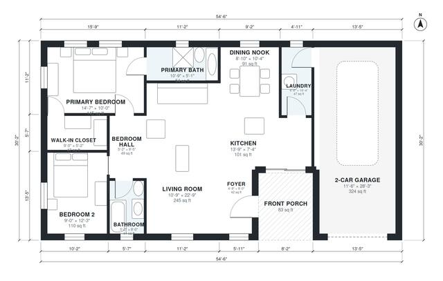

# Small House Plans with 2 Car Garage: 1,150 Sq Ft, 2 Bed

This is a single-story 2-bedroom, 2-bath home of about 1,150 sq ft of living space, plus a 2-car garage and a covered front porch. The open kitchen, dining nook and living room form the main space. The primary suite with its bath and walk-in closet is separated from bedroom 2 and the hall bath, and the laundry sits between the kitchen and garage as the garage entry.

| | |
|---|---|
| Levels | 1 |
| Footprint | 16.6 m × 9.2 m (54 ft × 30 ft) |
| Rooms | 12 indoor, 1 outdoor |
| Indoor area including garage, from the room grid | about 145 m² (1,560 sq ft) |

## Files here

- `area-schedule.csv` (room schedule)
- `building.json` (rooms, walls, openings as data)
- `plan-level1.dxf` (floor plan, DXF, drawing units: inches)

## More for this plan

- Plan page with the PDF plan set, IFC and 3D model, and a tool to change the plan: https://floorplan.ai-architectures.com/house-plans/small-house-plans-with-2-car-garage?utm_source=github-plans&utm_medium=probe&utm_campaign=github
- PDF plan set: https://storage.googleapis.com/20img/house-plans/small-house-plans-with-2-car-garage/plan-set.pdf
- IFC model: https://storage.googleapis.com/20img/house-plans/small-house-plans-with-2-car-garage/model.ifc

## Known issues in this drawing

- None found by the automatic checks.

Concept design generated with AI. Not for construction or permit; verify with a licensed professional.
