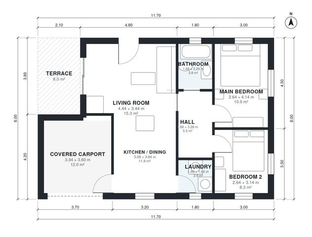

# Small House Plans With Carport: 2-Bed, 750 Sq Ft Single-Story

This is a compact single-story 2-bedroom, 1-bath home of about 70 m² of living space on an 11.7 x 8.0 m footprint. It has an open kitchen, dining and living area that opens to a small terrace. Both bedrooms and the bath are off a short hall. A laundry and a covered 1-car carport at the front complete the plan.

| | |
|---|---|
| Levels | 1 |
| Footprint | 11.7 m × 8.0 m (38 ft × 26 ft) |
| Rooms | 8 indoor, 1 outdoor |
| Indoor area including garage, from the room grid | about 86 m² (922 sq ft) |

## Files here

- `area-schedule.csv` (room schedule)
- `building.json` (rooms, walls, openings as data)
- `plan-level1.dxf` (floor plan, DXF, drawing units: millimetres)

## More for this plan

- Plan page with the PDF plan set, IFC and 3D model, and a tool to change the plan: https://floorplan.ai-architectures.com/house-plans/small-house-plans-with-carport?utm_source=github-plans&utm_medium=probe&utm_campaign=github
- PDF plan set: https://storage.googleapis.com/20img/house-plans/small-house-plans-with-carport/plan-set.pdf
- IFC model: https://storage.googleapis.com/20img/house-plans/small-house-plans-with-carport/model.ifc

## Known issues in this drawing

- Main Bedroom is only 2.64 m wide.

Concept design generated with AI. Not for construction or permit; verify with a licensed professional.
