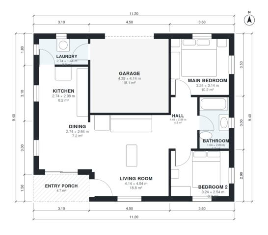

# Small House Plans With Garage 80 m2 | 2 Bed, 1 Bath, 870 Sq Ft

This compact single-storey home has about 80 m² of living space, plus an attached 1-car garage. A covered porch opens into an open living, dining and kitchen area. A short hall leads to two bedrooms and a shared bathroom. The laundry links the kitchen to the garage, so groceries and laundry have a direct route.

| | |
|---|---|
| Levels | 1 |
| Footprint | 11.2 m × 9.4 m (37 ft × 31 ft) |
| Rooms | 9 indoor, 1 outdoor |
| Indoor area including garage, from the room grid | about 101 m² (1,083 sq ft) |

## Files here

- `area-schedule.csv` (room schedule)
- `building.json` (rooms, walls, openings as data)
- `plan-level1.dxf` (floor plan, DXF, drawing units: millimetres)

## More for this plan

- Plan page with the PDF plan set, IFC and 3D model, and a tool to change the plan: https://floorplan.ai-architectures.com/house-plans/small-house-plans-with-garage-80-m2?utm_source=github-plans&utm_medium=probe&utm_campaign=github
- PDF plan set: https://storage.googleapis.com/20img/house-plans/small-house-plans-with-garage-80-m2/plan-set.pdf
- IFC model: https://storage.googleapis.com/20img/house-plans/small-house-plans-with-garage-80-m2/model.ifc

## Known issues in this drawing

- None found by the automatic checks.

Concept design generated with AI. Not for construction or permit; verify with a licensed professional.
