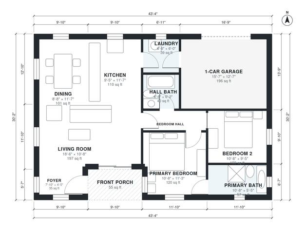

# Small House Plans With Garage: 2 Bed, 2 Bath, 1,020 Sq Ft

This is a compact single-story farmhouse-style home of about 94 m² (roughly 1,010 sq ft) of living space, plus a 1-car garage and a small front porch. The kitchen, dining and living areas form one open space with good daylight. The two bedrooms are off a private hall, and the primary bedroom has its own bath. The garage enters through the laundry, which connects to the kitchen.

| | |
|---|---|
| Levels | 1 |
| Footprint | 13.2 m × 9.2 m (43 ft × 30 ft) |
| Rooms | 11 indoor, 1 outdoor |
| Indoor area including garage, from the room grid | about 116 m² (1,252 sq ft) |

## Files here

- `area-schedule.csv` (room schedule)
- `building.json` (rooms, walls, openings as data)
- `plan-level1.dxf` (floor plan, DXF, drawing units: inches)

## More for this plan

- Plan page with the PDF plan set, IFC and 3D model, and a tool to change the plan: https://floorplan.ai-architectures.com/house-plans/small-house-plans-with-garage?utm_source=github-plans&utm_medium=probe&utm_campaign=github
- PDF plan set: https://storage.googleapis.com/20img/house-plans/small-house-plans-with-garage/plan-set.pdf
- IFC model: https://storage.googleapis.com/20img/house-plans/small-house-plans-with-garage/model.ifc

## Known issues in this drawing

- Foyer is 3.2 m² (asked for about 5.0 m²).

Concept design generated with AI. Not for construction or permit; verify with a licensed professional.
