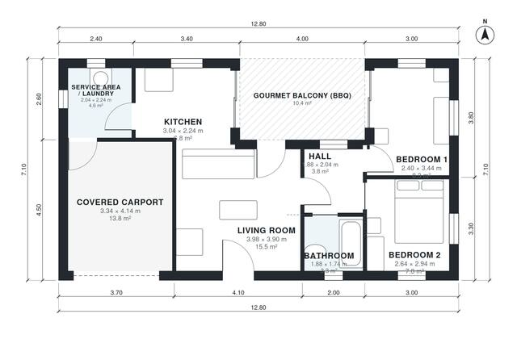

# Small House Plans with Gourmet Balcony | 2 Bed 690 Sq Ft

A compact single-storey home of about 66 m² of interior space, plus a 13.8 m² covered carport and a 10.4 m² covered gourmet balcony with a barbecue grill. The open kitchen and living room share the balcony. A short hall leads to two bedrooms and a bathroom, and a service and laundry area sits next to the kitchen with a connection to the carport.

| | |
|---|---|
| Levels | 1 |
| Footprint | 12.8 m × 7.1 m (42 ft × 23 ft) |
| Rooms | 8 indoor, 1 outdoor |
| Indoor area including garage, from the room grid | about 80 m² (866 sq ft) |

## Files here

- `area-schedule.csv` (room schedule)
- `building.json` (rooms, walls, openings as data)
- `plan-level1.dxf` (floor plan, DXF, drawing units: millimetres)

## More for this plan

- Plan page with the PDF plan set, IFC and 3D model, and a tool to change the plan: https://floorplan.ai-architectures.com/house-plans/small-house-plans-with-gourmet-balcony?utm_source=github-plans&utm_medium=probe&utm_campaign=github
- PDF plan set: https://storage.googleapis.com/20img/house-plans/small-house-plans-with-gourmet-balcony/plan-set.pdf
- IFC model: https://storage.googleapis.com/20img/house-plans/small-house-plans-with-gourmet-balcony/model.ifc

## Known issues in this drawing

- Living Room has no window.
- Bathroom is 3.3 m² (asked for about 4.5 m²).
- Kitchen is 6.8 m² (asked for about 10.0 m²).
- Bedroom 1 is only 2.40 m wide.

Concept design generated with AI. Not for construction or permit; verify with a licensed professional.
