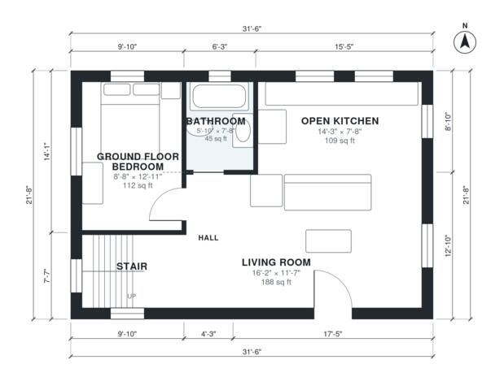

# Small House Plans With Loft: 2 Bed, 2 Bath, 1,180 Sq Ft

This is a compact two-level cottage of about 102 m² (1,100 sq ft) of living space. The ground floor has an open kitchen and living room, a bedroom and a bath, all arranged around a short hall beside the stair. Upstairs are a bright loft sitting area, a second bedroom and a small bath, with part of the lower roof left open below.

| | |
|---|---|
| Levels | 2 |
| Footprint | 9.6 m × 6.6 m (31 ft × 22 ft) |
| Rooms | 10 indoor, 1 outdoor |
| Indoor area including garage, from the room grid | about 110 m² (1,181 sq ft) |

## Files here

- `area-schedule.csv` (room schedule)
- `building.json` (rooms, walls, openings as data)
- `plan-level1.dxf` (floor plan, DXF, drawing units: inches)
- `plan-level2.dxf` (floor plan, DXF, drawing units: inches)

## More for this plan

- Plan page with the PDF plan set, IFC and 3D model, and a tool to change the plan: https://floorplan.ai-architectures.com/house-plans/small-house-plans-with-loft?utm_source=github-plans&utm_medium=probe&utm_campaign=github
- PDF plan set: https://storage.googleapis.com/20img/house-plans/small-house-plans-with-loft/plan-set.pdf
- IFC model: https://storage.googleapis.com/20img/house-plans/small-house-plans-with-loft/model.ifc

## Known issues in this drawing

- Upstairs Bath is 3.2 m² (asked for about 4.5 m²).
- Upstairs Bedroom is only 2.30 m wide.

Concept design generated with AI. Not for construction or permit; verify with a licensed professional.
