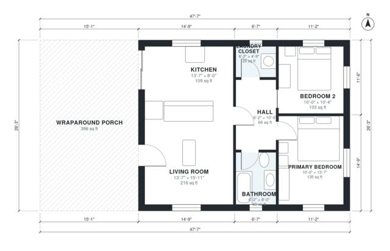

# Small House Plans With Porch: 850 Sq Ft, 2 Bed, 1 Bath

This is a single-story cottage with about 88 m² (950 sq ft) of living space, plus an L-shaped porch that wraps the front and east side. The front door opens into a bright open living room and kitchen. A short hall leads to two bedrooms, a full bath and a laundry closet, so the sleeping area stays private. The kitchen also opens onto the side porch.

| | |
|---|---|
| Levels | 1 |
| Footprint | 14.5 m × 8.0 m (48 ft × 26 ft) |
| Rooms | 7 indoor, 1 outdoor |
| Indoor area including garage, from the room grid | about 79 m² (853 sq ft) |

## Files here

- `area-schedule.csv` (room schedule)
- `building.json` (rooms, walls, openings as data)
- `plan-level1.dxf` (floor plan, DXF, drawing units: inches)

## More for this plan

- Plan page with the PDF plan set, IFC and 3D model, and a tool to change the plan: https://floorplan.ai-architectures.com/house-plans/small-house-plans-with-porch?utm_source=github-plans&utm_medium=probe&utm_campaign=github
- PDF plan set: https://storage.googleapis.com/20img/house-plans/small-house-plans-with-porch/plan-set.pdf
- IFC model: https://storage.googleapis.com/20img/house-plans/small-house-plans-with-porch/model.ifc

## Known issues in this drawing

- None found by the automatic checks.

Concept design generated with AI. Not for construction or permit; verify with a licensed professional.
