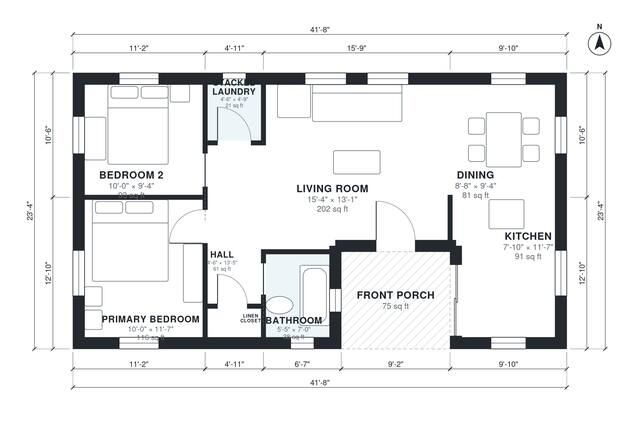

# Small House Plans: 2-Bedroom, 1-Bath, 900 Sq Ft Plan

This is an efficient single-storey 2-bedroom, 1-bath cottage of about 90 m² (970 sq ft) including the front porch, which is close to your 900 sq ft target. The porch opens into an open kitchen, dining and living area. A short hall serves both bedrooms, the shared bath and a stacked laundry closet, so the sleeping area stays private. The kitchen and bath came out slightly smaller than first planned, and we can rebalance them if you want.

| | |
|---|---|
| Levels | 1 |
| Footprint | 12.7 m × 7.1 m (42 ft × 23 ft) |
| Rooms | 9 indoor, 1 outdoor |
| Indoor area including garage, from the room grid | about 83 m² (895 sq ft) |

## Files here

- `area-schedule.csv` (room schedule)
- `building.json` (rooms, walls, openings as data)
- `plan-level1.dxf` (floor plan, DXF, drawing units: inches)

## More for this plan

- Plan page with the PDF plan set, IFC and 3D model, and a tool to change the plan: https://floorplan.ai-architectures.com/house-plans/small-house-plans?utm_source=github-plans&utm_medium=probe&utm_campaign=github
- PDF plan set: https://storage.googleapis.com/20img/house-plans/small-house-plans/plan-set.pdf
- IFC model: https://storage.googleapis.com/20img/house-plans/small-house-plans/model.ifc

## Known issues in this drawing

- Bathroom is 3.5 m² (asked for about 5.0 m²).
- Kitchen is 8.5 m² (asked for about 12.0 m²).

Concept design generated with AI. Not for construction or permit; verify with a licensed professional.
