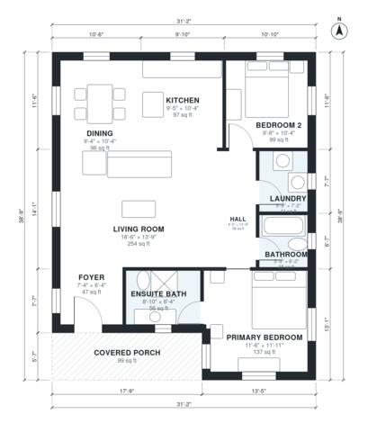

# Small Lot House Plans: 1,110 Sq Ft 2 Bed 2 Bath Ranch

This is a compact single-story cottage of about 1,110 sq ft indoors, with a 100 sq ft covered porch at the front. You enter through a small foyer into an open kitchen, dining and living area. A short hall leads to two bedrooms, a primary ensuite, a hall bath and a laundry. It fits the small-lot brief.

| | |
|---|---|
| Levels | 1 |
| Footprint | 9.5 m × 11.8 m (31 ft × 39 ft) |
| Rooms | 10 indoor, 1 outdoor |
| Indoor area including garage, from the room grid | about 103 m² (1,108 sq ft) |

## Files here

- `area-schedule.csv` (room schedule)
- `building.json` (rooms, walls, openings as data)
- `plan-level1.dxf` (floor plan, DXF, drawing units: inches)

## More for this plan

- Plan page with the PDF plan set, IFC and 3D model, and a tool to change the plan: https://floorplan.ai-architectures.com/house-plans/small-lot-house-plans?utm_source=github-plans&utm_medium=probe&utm_campaign=github
- PDF plan set: https://storage.googleapis.com/20img/house-plans/small-lot-house-plans/plan-set.pdf
- IFC model: https://storage.googleapis.com/20img/house-plans/small-lot-house-plans/model.ifc

## Known issues in this drawing

- Bathroom is 3.3 m² (asked for about 5.0 m²).

Concept design generated with AI. Not for construction or permit; verify with a licensed professional.
