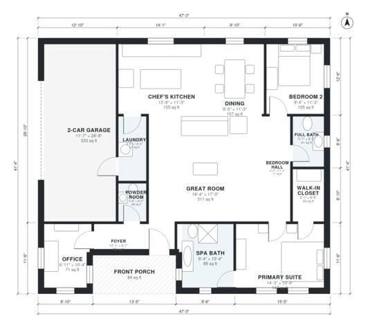

# Small Luxury House Plans: 2 Bed, 1,490 Sq Ft One-Story

This is a single-story home of about 135 m² (1,450 sq ft) of living space, plus an attached 2-car garage and a front porch. It has an open great room, chef's kitchen with island and dining area, a front office, and a primary suite with a spa bath and walk-in closet. A second bedroom and full bath sit off a separate hall. Small adjustments to the foyer, powder room and dining proportions will make the entry and secondary rooms more comfortable.

| | |
|---|---|
| Levels | 1 |
| Footprint | 14.4 m × 12.6 m (47 ft × 41 ft) |
| Rooms | 14 indoor, 1 outdoor |
| Indoor area including garage, from the room grid | about 174 m² (1,869 sq ft) |

## Files here

- `area-schedule.csv` (room schedule)
- `building.json` (rooms, walls, openings as data)
- `plan-level1.dxf` (floor plan, DXF, drawing units: inches)

## More for this plan

- Plan page with the PDF plan set, IFC and 3D model, and a tool to change the plan: https://floorplan.ai-architectures.com/house-plans/small-luxury-house-plans?utm_source=github-plans&utm_medium=probe&utm_campaign=github
- PDF plan set: https://storage.googleapis.com/20img/house-plans/small-luxury-house-plans/plan-set.pdf
- IFC model: https://storage.googleapis.com/20img/house-plans/small-luxury-house-plans/model.ifc

## Known issues in this drawing

- Office is 6.6 m² (asked for about 9.0 m²).
- Foyer is only 1.24 m wide.
- Great Room has no window.

Concept design generated with AI. Not for construction or permit; verify with a licensed professional.
