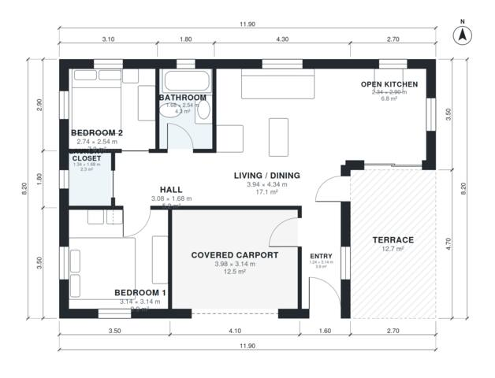

# Small Minimalist House Plans: 760 Sq Ft 2-Bed Flat-Roof Home

A compact single-storey flat-roof cube of about 70 m² (753 sq ft) of living space on a 10.6 x 9.2 m footprint. The open kitchen and living/dining area faces a rear terrace through glass doors. Two bedrooms, a bathroom and a laundry closet sit off a short hall, and a covered one-car carport is at the front next to the entry.

| | |
|---|---|
| Levels | 1 |
| Footprint | 11.9 m × 8.2 m (39 ft × 27 ft) |
| Rooms | 9 indoor, 1 outdoor |
| Indoor area including garage, from the room grid | about 85 m² (914 sq ft) |

## Files here

- `area-schedule.csv` (room schedule)
- `building.json` (rooms, walls, openings as data)
- `plan-level1.dxf` (floor plan, DXF, drawing units: millimetres)

## More for this plan

- Plan page with the PDF plan set, IFC and 3D model, and a tool to change the plan: https://floorplan.ai-architectures.com/house-plans/small-minimalist-house-plans?utm_source=github-plans&utm_medium=probe&utm_campaign=github
- PDF plan set: https://storage.googleapis.com/20img/house-plans/small-minimalist-house-plans/plan-set.pdf
- IFC model: https://storage.googleapis.com/20img/house-plans/small-minimalist-house-plans/model.ifc

## Known issues in this drawing

- Entry is only 1.24 m wide.
- Bedroom 2 is 7.0 m² (asked for about 10.5 m²).
- Open Kitchen is 6.8 m² (asked for about 10.0 m²).

Concept design generated with AI. Not for construction or permit; verify with a licensed professional.
