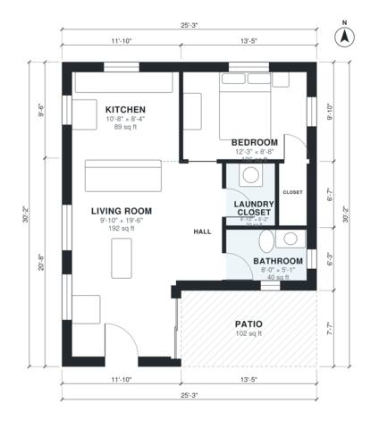

# Small Modern 1 Bedroom House Plans: 660 Sq Ft Single Story

This is a compact single-story modern one-bedroom home of about 61 m² (roughly 655 sq ft) of living space, plus a 10 m² patio. The open kitchen and living area connects through glass doors to the patio. The bedroom has its own closet, and the bathroom and laundry closet are grouped off the hall.

| | |
|---|---|
| Levels | 1 |
| Footprint | 7.7 m × 9.2 m (25 ft × 30 ft) |
| Rooms | 7 indoor, 1 outdoor |
| Indoor area including garage, from the room grid | about 61 m² (661 sq ft) |

## Files here

- `area-schedule.csv` (room schedule)
- `building.json` (rooms, walls, openings as data)
- `plan-level1.dxf` (floor plan, DXF, drawing units: inches)

## More for this plan

- Plan page with the PDF plan set, IFC and 3D model, and a tool to change the plan: https://floorplan.ai-architectures.com/house-plans/small-modern-1-bedroom-house-plans?utm_source=github-plans&utm_medium=probe&utm_campaign=github
- PDF plan set: https://storage.googleapis.com/20img/house-plans/small-modern-1-bedroom-house-plans/plan-set.pdf
- IFC model: https://storage.googleapis.com/20img/house-plans/small-modern-1-bedroom-house-plans/model.ifc

## Known issues in this drawing

- Living Room is only 3.00 m wide.

Concept design generated with AI. Not for construction or permit; verify with a licensed professional.
