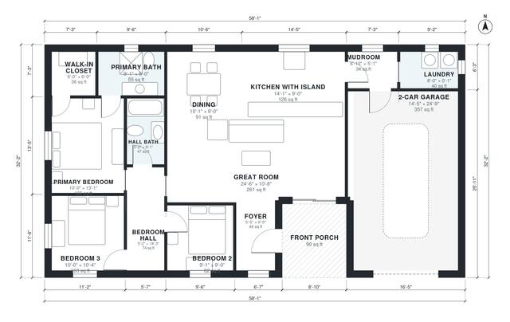

# Small Modern Farmhouse Plans: 3-Bed, 2-Bath, 1,350 Sq Ft

This is a single-story modern farmhouse of about 130 m² (1,400 sq ft) of living space, plus a 2-car garage and a front porch. An open great room, kitchen with island and dining area form the main living space. The three bedrooms sit in a quiet wing off a central hall, with the primary suite at the end. The mudroom and laundry link the kitchen to the garage.

| | |
|---|---|
| Levels | 1 |
| Footprint | 17.7 m × 9.8 m (58 ft × 32 ft) |
| Rooms | 14 indoor, 1 outdoor |
| Indoor area including garage, from the room grid | about 165 m² (1,777 sq ft) |

## Files here

- `area-schedule.csv` (room schedule)
- `building.json` (rooms, walls, openings as data)
- `plan-level1.dxf` (floor plan, DXF, drawing units: inches)

## More for this plan

- Plan page with the PDF plan set, IFC and 3D model, and a tool to change the plan: https://floorplan.ai-architectures.com/house-plans/small-modern-farmhouse-plans?utm_source=github-plans&utm_medium=probe&utm_campaign=github
- PDF plan set: https://storage.googleapis.com/20img/house-plans/small-modern-farmhouse-plans/plan-set.pdf
- IFC model: https://storage.googleapis.com/20img/house-plans/small-modern-farmhouse-plans/model.ifc

## Known issues in this drawing

- Bedroom 2 is 7.6 m² (asked for about 11.0 m²).
- Mudroom is 3.2 m² (asked for about 5.0 m²).

Concept design generated with AI. Not for construction or permit; verify with a licensed professional.
