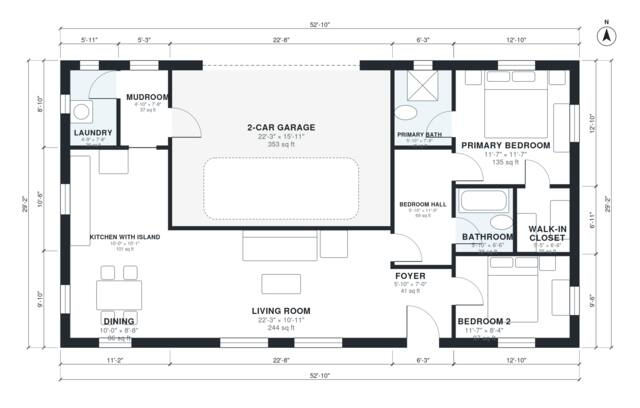

# Small Modern House Plans with Garage: 2 Bed, 1,160 Sq Ft

This is a single-story modern home with about 106 m² (1,150 sq ft) of living space, plus an attached 38 m² two-car garage. The open kitchen with island, dining and living area runs along the west side with large windows. The two bedrooms sit in a quiet wing off a hall, and the primary has its own bath and walk-in closet. The garage enters through a mudroom beside the laundry.

| | |
|---|---|
| Levels | 1 |
| Footprint | 16.1 m × 8.9 m (53 ft × 29 ft) |
| Rooms | 13 indoor, 0 outdoor |
| Indoor area including garage, from the room grid | about 143 m² (1,542 sq ft) |

## Files here

- `area-schedule.csv` (room schedule)
- `building.json` (rooms, walls, openings as data)
- `plan-level1.dxf` (floor plan, DXF, drawing units: inches)

## More for this plan

- Plan page with the PDF plan set, IFC and 3D model, and a tool to change the plan: https://floorplan.ai-architectures.com/house-plans/small-modern-house-plans-with-garage?utm_source=github-plans&utm_medium=probe&utm_campaign=github
- PDF plan set: https://storage.googleapis.com/20img/house-plans/small-modern-house-plans-with-garage/plan-set.pdf
- IFC model: https://storage.googleapis.com/20img/house-plans/small-modern-house-plans-with-garage/model.ifc

## Known issues in this drawing

- Bedroom Hall and Bedroom 2 are not directly connected.
- Living Room is only 3.34 m wide.

Concept design generated with AI. Not for construction or permit; verify with a licensed professional.
