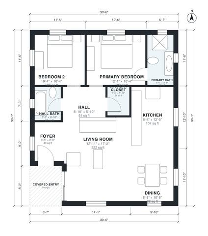

# Small Modern House Plans: 1-Story, 2 Bed, 2 Bath, 1,050 Sq Ft

This is a compact one-story modern home of about 1,100 sq ft (roughly 102 m²) under a flat roof. A covered entry opens through a small foyer into an open kitchen, dining and living space with large windows. A short hall serves the two bedrooms, the primary bath, the hall bath and the laundry closet, so the sleeping areas stay private.

| | |
|---|---|
| Levels | 1 |
| Footprint | 9.3 m × 11.0 m (31 ft × 36 ft) |
| Rooms | 10 indoor, 1 outdoor |
| Indoor area including garage, from the room grid | about 97 m² (1,047 sq ft) |

## Files here

- `area-schedule.csv` (room schedule)
- `building.json` (rooms, walls, openings as data)
- `plan-level1.dxf` (floor plan, DXF, drawing units: inches)

## More for this plan

- Plan page with the PDF plan set, IFC and 3D model, and a tool to change the plan: https://floorplan.ai-architectures.com/house-plans/small-modern-house-plans?utm_source=github-plans&utm_medium=probe&utm_campaign=github
- PDF plan set: https://storage.googleapis.com/20img/house-plans/small-modern-house-plans/plan-set.pdf
- IFC model: https://storage.googleapis.com/20img/house-plans/small-modern-house-plans/model.ifc

## Known issues in this drawing

- Hall Bath is 3.4 m² (asked for about 5.0 m²).

Concept design generated with AI. Not for construction or permit; verify with a licensed professional.
