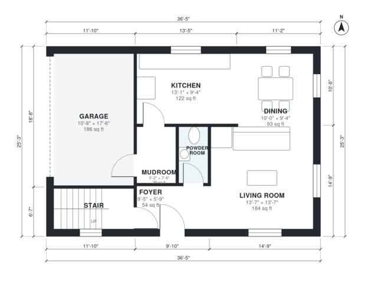

# Small Modern Two Story House Plans: 3 Bed, 1,460 Sq Ft

This is a compact modern two-storey home of about 138 m² (about 1,480 sq ft) of living space, plus a 1-car garage. The ground floor has an open kitchen, dining and living area, a powder room, and a garage that opens straight into the kitchen. Upstairs there are three bedrooms, two baths, a laundry and a terrace off the primary suite.

| | |
|---|---|
| Levels | 2 |
| Footprint | 11.1 m × 7.7 m (36 ft × 25 ft) |
| Rooms | 16 indoor, 1 outdoor |
| Indoor area including garage, from the room grid | about 156 m² (1,679 sq ft) |

## Files here

- `area-schedule.csv` (room schedule)
- `building.json` (rooms, walls, openings as data)
- `plan-level1.dxf` (floor plan, DXF, drawing units: inches)
- `plan-level2.dxf` (floor plan, DXF, drawing units: inches)

## More for this plan

- Plan page with the PDF plan set, IFC and 3D model, and a tool to change the plan: https://floorplan.ai-architectures.com/house-plans/small-modern-two-story-house-plans?utm_source=github-plans&utm_medium=probe&utm_campaign=github
- PDF plan set: https://storage.googleapis.com/20img/house-plans/small-modern-two-story-house-plans/plan-set.pdf
- IFC model: https://storage.googleapis.com/20img/house-plans/small-modern-two-story-house-plans/model.ifc

## Known issues in this drawing

- Stair and Upper Hall are not directly connected.
- Primary Bedroom is only 2.44 m wide.

Concept design generated with AI. Not for construction or permit; verify with a licensed professional.
