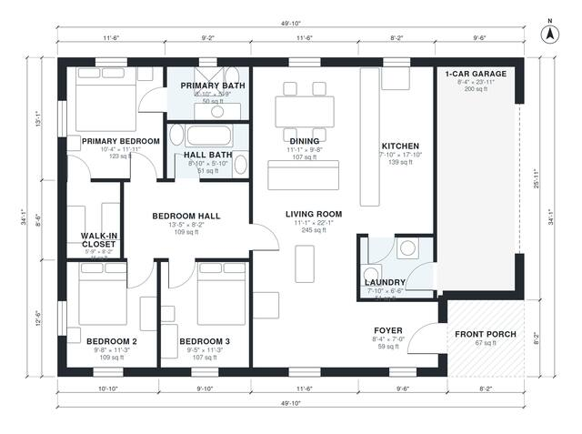

# Small One Story House Plans: 3 Bed, 2 Bath, 1,390 Sq Ft

A single-story ranch of about 116 m² (1,250 sq ft) of living space, plus a 1-car garage and a front porch. The open kitchen, dining and living area runs along the front-to-back centre of the house. A bedroom hall serves the primary suite (ensuite and walk-in closet), two more bedrooms and a hall bath. The garage opens into the laundry. I'm making the garage and Bedroom 3 a little wider for comfort.

| | |
|---|---|
| Levels | 1 |
| Footprint | 15.2 m × 10.4 m (50 ft × 34 ft) |
| Rooms | 13 indoor, 1 outdoor |
| Indoor area including garage, from the room grid | about 152 m² (1,634 sq ft) |

## Files here

- `area-schedule.csv` (room schedule)
- `building.json` (rooms, walls, openings as data)
- `plan-level1.dxf` (floor plan, DXF, drawing units: inches)

## More for this plan

- Plan page with the PDF plan set, IFC and 3D model, and a tool to change the plan: https://floorplan.ai-architectures.com/house-plans/small-one-story-house-plans?utm_source=github-plans&utm_medium=probe&utm_campaign=github
- PDF plan set: https://storage.googleapis.com/20img/house-plans/small-one-story-house-plans/plan-set.pdf
- IFC model: https://storage.googleapis.com/20img/house-plans/small-one-story-house-plans/model.ifc

## Known issues in this drawing

- 1-Car Garage is only 2.54 m wide.

Concept design generated with AI. Not for construction or permit; verify with a licensed professional.
