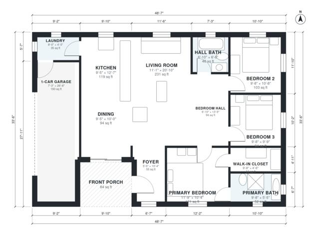

# Small Ranch House Plans: 3 Bed, 2 Bath, 1,280 Sq Ft Home

A single-story ranch of about 1,300 sq ft of living space, with an open kitchen, living and dining area across the front. A covered porch opens to the foyer, and the 1-car garage enters through the laundry. Three bedrooms sit off a separate hall, and the primary suite has its own bath. The revision gives every bedroom a window and a bit more room in the foyer, laundry and hall bath.

| | |
|---|---|
| Levels | 1 |
| Footprint | 14.8 m × 10.2 m (49 ft × 33 ft) |
| Rooms | 13 indoor, 1 outdoor |
| Indoor area including garage, from the room grid | about 143 m² (1,541 sq ft) |

## Files here

- `area-schedule.csv` (room schedule)
- `building.json` (rooms, walls, openings as data)
- `plan-level1.dxf` (floor plan, DXF, drawing units: inches)

## More for this plan

- Plan page with the PDF plan set, IFC and 3D model, and a tool to change the plan: https://floorplan.ai-architectures.com/house-plans/small-ranch-house-plans?utm_source=github-plans&utm_medium=probe&utm_campaign=github
- PDF plan set: https://storage.googleapis.com/20img/house-plans/small-ranch-house-plans/plan-set.pdf
- IFC model: https://storage.googleapis.com/20img/house-plans/small-ranch-house-plans/model.ifc

## Known issues in this drawing

- 1-Car Garage is only 2.20 m wide.
- Laundry is 3.3 m² (asked for about 4.5 m²).

Concept design generated with AI. Not for construction or permit; verify with a licensed professional.
