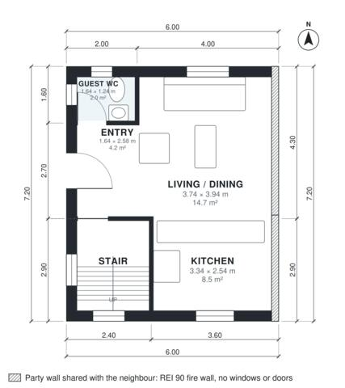

# Small Semi Detached House Plans: 2 Bed, 930 Sq Ft, 2 Story

This is a compact semi-detached house of about 86 m² on two floors, 6 m wide, with the party wall on the right and no openings in it. The ground floor is an open kitchen, living and dining space with a guest WC beside the entry. Upstairs are two bedrooms and a bath, all opening off a central landing. Built against the neighbours on the right (party wall, fire wall without windows or doors); the rooms take their daylight from the free sides.

| | |
|---|---|
| Levels | 2 |
| Footprint | 6.0 m × 7.2 m (20 ft × 24 ft) |
| Rooms | 10 indoor, 0 outdoor |
| Indoor area including garage, from the room grid | about 86 m² (930 sq ft) |

## Files here

- `area-schedule.csv` (room schedule)
- `building.json` (rooms, walls, openings as data)
- `plan-level1.dxf` (floor plan, DXF, drawing units: millimetres)
- `plan-level2.dxf` (floor plan, DXF, drawing units: millimetres)

## More for this plan

- Plan page with the PDF plan set, IFC and 3D model, and a tool to change the plan: https://floorplan.ai-architectures.com/house-plans/small-semi-detached-house-plans?utm_source=github-plans&utm_medium=probe&utm_campaign=github
- PDF plan set: https://storage.googleapis.com/20img/house-plans/small-semi-detached-house-plans/plan-set.pdf
- IFC model: https://storage.googleapis.com/20img/house-plans/small-semi-detached-house-plans/model.ifc

## Known issues in this drawing

- Bedroom 1 is only 2.84 m wide.

Concept design generated with AI. Not for construction or permit; verify with a licensed professional.
