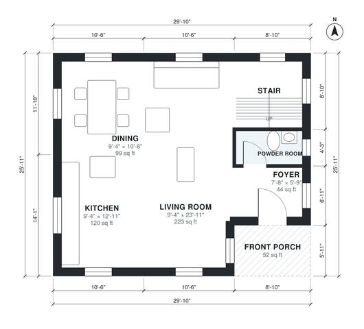

# Small Two Story House Plans: 3 Bed, 2.5 Bath, 1,500 Sq Ft

This is a compact two-storey home of about 145 m² (about 1,560 sq ft), plus a covered front porch and no garage. The ground floor has a foyer, an open living, kitchen and dining space with the stair, and a powder room. Upstairs, a central hall serves the primary bedroom with its own bath, two more bedrooms, a hall bath and the laundry.

| | |
|---|---|
| Levels | 2 |
| Footprint | 9.1 m × 7.9 m (30 ft × 26 ft) |
| Rooms | 14 indoor, 1 outdoor |
| Indoor area including garage, from the room grid | about 139 m² (1,495 sq ft) |

## Files here

- `area-schedule.csv` (room schedule)
- `building.json` (rooms, walls, openings as data)
- `plan-level1.dxf` (floor plan, DXF, drawing units: inches)
- `plan-level2.dxf` (floor plan, DXF, drawing units: inches)

## More for this plan

- Plan page with the PDF plan set, IFC and 3D model, and a tool to change the plan: https://floorplan.ai-architectures.com/house-plans/small-two-story-house-plans?utm_source=github-plans&utm_medium=probe&utm_campaign=github
- PDF plan set: https://storage.googleapis.com/20img/house-plans/small-two-story-house-plans/plan-set.pdf
- IFC model: https://storage.googleapis.com/20img/house-plans/small-two-story-house-plans/model.ifc

## Known issues in this drawing

- Living Room is only 2.84 m wide.
- Foyer is 4.1 m² (asked for about 6.0 m²).
- Bedroom 3 is only 2.34 m wide.

Concept design generated with AI. Not for construction or permit; verify with a licensed professional.
