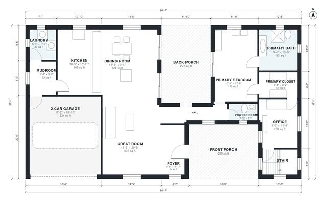

# Southern House Plans: 4-Bed, 2-Story, 2,670 Sq Ft Design

A two-story Southern home of roughly 235 m² (about 2,500 sq ft) of living space, not counting the 40 m² two-car garage or the deep front and back porches. The ground floor has the primary suite with bath and walk-in closet, foyer, great room open to kitchen and dining, office, powder room, mudroom and laundry. Upstairs, three bedrooms and two baths open off one hall.

| | |
|---|---|
| Levels | 2 |
| Footprint | 20.3 m × 11.3 m (67 ft × 37 ft) |
| Rooms | 22 indoor, 3 outdoor |
| Indoor area including garage, from the room grid | about 282 m² (3,038 sq ft) |

## Files here

- `area-schedule.csv` (room schedule)
- `building.json` (rooms, walls, openings as data)
- `plan-level1.dxf` (floor plan, DXF, drawing units: inches)
- `plan-level2.dxf` (floor plan, DXF, drawing units: inches)

## More for this plan

- Plan page with the PDF plan set, IFC and 3D model, and a tool to change the plan: https://floorplan.ai-architectures.com/house-plans/southern-house-plans?utm_source=github-plans&utm_medium=probe&utm_campaign=github
- PDF plan set: https://storage.googleapis.com/20img/house-plans/southern-house-plans/plan-set.pdf
- IFC model: https://storage.googleapis.com/20img/house-plans/southern-house-plans/model.ifc

## Known issues in this drawing

- Foyer and Office are not directly connected.
- Foyer is 6.0 m² (asked for about 8.0 m²).

Concept design generated with AI. Not for construction or permit; verify with a licensed professional.
