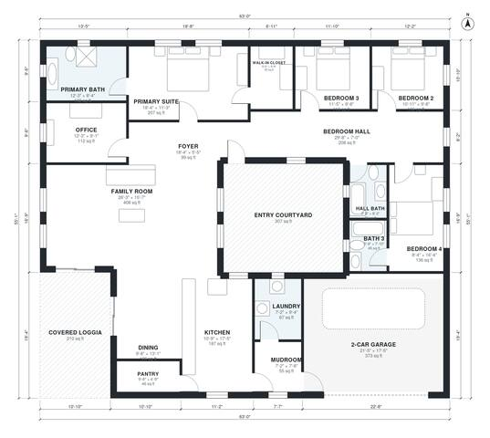

# Spanish Style House Plans: 4 Bed, 3 Bath, 2,520 Sq Ft

A single-story Spanish Colonial home of roughly 2,450 sq ft of living space, plus a 2-car garage, entered through a front courtyard and foyer. The kitchen, dining and family room form one open space that reaches the covered loggia. The four bedrooms are in a separate wing off a central hall, with a primary suite (bath and walk-in closet) and a private bath for Bedroom 4.

| | |
|---|---|
| Levels | 1 |
| Footprint | 19.2 m × 16.8 m (63 ft × 55 ft) |
| Rooms | 18 indoor, 2 outdoor |
| Indoor area including garage, from the room grid | about 275 m² (2,955 sq ft) |

## Files here

- `area-schedule.csv` (room schedule)
- `building.json` (rooms, walls, openings as data)
- `plan-level1.dxf` (floor plan, DXF, drawing units: inches)

## More for this plan

- Plan page with the PDF plan set, IFC and 3D model, and a tool to change the plan: https://floorplan.ai-architectures.com/house-plans/spanish-style-house-plans?utm_source=github-plans&utm_medium=probe&utm_campaign=github
- PDF plan set: https://storage.googleapis.com/20img/house-plans/spanish-style-house-plans/plan-set.pdf
- IFC model: https://storage.googleapis.com/20img/house-plans/spanish-style-house-plans/model.ifc

## Known issues in this drawing

- Bedroom Hall and Primary Suite are not directly connected.
- Dining is 11.7 m² (asked for about 16.0 m²).

Concept design generated with AI. Not for construction or permit; verify with a licensed professional.
