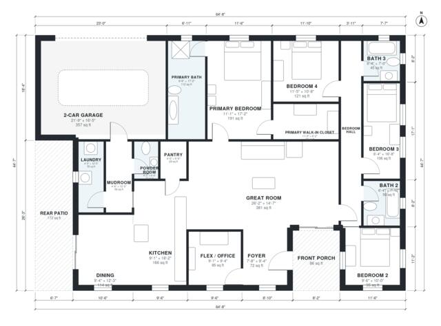

# Split Bedroom Floor Plans: 4-Bed, 2,200 Sq Ft Single Story

This single-story split-bedroom ranch has about 2,270 sq ft of heated living space, plus a 2-car garage, front porch and rear patio. The primary suite, with its large bath and walk-in closet, sits on one side. Three bedrooms and two baths are grouped along a private hall on the other side. The open great room, kitchen and dining area sit in the middle. A flex/office room is off the foyer, and the garage enters through a mudroom with laundry and a powder room.

| | |
|---|---|
| Levels | 1 |
| Footprint | 19.7 m × 13.6 m (65 ft × 45 ft) |
| Rooms | 19 indoor, 2 outdoor |
| Indoor area including garage, from the room grid | about 244 m² (2,626 sq ft) |

## Files here

- `area-schedule.csv` (room schedule)
- `building.json` (rooms, walls, openings as data)
- `plan-level1.dxf` (floor plan, DXF, drawing units: inches)

## More for this plan

- Plan page with the PDF plan set, IFC and 3D model, and a tool to change the plan: https://floorplan.ai-architectures.com/house-plans/split-bedroom-floor-plans?utm_source=github-plans&utm_medium=probe&utm_campaign=github
- PDF plan set: https://storage.googleapis.com/20img/house-plans/split-bedroom-floor-plans/plan-set.pdf
- IFC model: https://storage.googleapis.com/20img/house-plans/split-bedroom-floor-plans/model.ifc

## Known issues in this drawing

- Bedroom 2 is 8.8 m² (asked for about 13.0 m²).
- Bedroom 3 is only 1.94 m wide.

Concept design generated with AI. Not for construction or permit; verify with a licensed professional.
