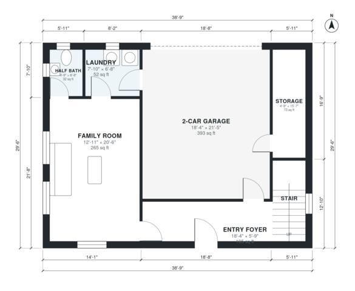

# Split Foyer House Plans: 3 Bed, 2.5 Bath, 1,860 Sq Ft

This is a 106 m² per floor split-foyer home, with about 170 m² (1,830 sq ft) of living space plus a 2-car garage. The entry foyer leads down to the family room, laundry, half bath, storage and garage. It leads up to an open kitchen, dining and living level with three bedrooms and two baths. The revision widens the kitchen, enlarges the ensuite and half bath, and trims the upper hall.

| | |
|---|---|
| Levels | 2 |
| Footprint | 11.8 m × 9.0 m (39 ft × 30 ft) |
| Rooms | 17 indoor, 0 outdoor |
| Indoor area including garage, from the room grid | about 212 m² (2,286 sq ft) |

## Files here

- `area-schedule.csv` (room schedule)
- `building.json` (rooms, walls, openings as data)
- `plan-level1.dxf` (floor plan, DXF, drawing units: inches)
- `plan-level2.dxf` (floor plan, DXF, drawing units: inches)

## More for this plan

- Plan page with the PDF plan set, IFC and 3D model, and a tool to change the plan: https://floorplan.ai-architectures.com/house-plans/split-foyer-house-plans?utm_source=github-plans&utm_medium=probe&utm_campaign=github
- PDF plan set: https://storage.googleapis.com/20img/house-plans/split-foyer-house-plans/plan-set.pdf
- IFC model: https://storage.googleapis.com/20img/house-plans/split-foyer-house-plans/model.ifc

## Known issues in this drawing

- Bedroom 2 is only 2.28 m wide.
- Living Room is 14.8 m² (asked for about 20.0 m²).

Concept design generated with AI. Not for construction or permit; verify with a licensed professional.
