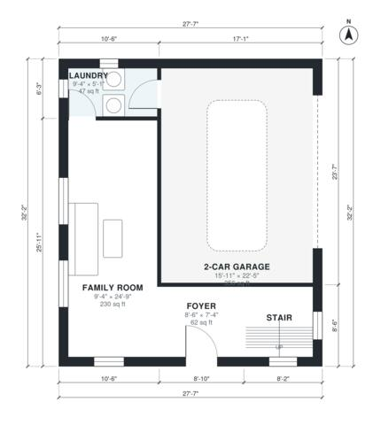

# Split Level House Plans: 3 Bed, 2 Bath, 1,960 Sq Ft Home

This is a three-level split-level home of about 1,900 sq ft of living space plus an attached 2-car garage. The entry level has an open living, dining and kitchen. The level below has the foyer, family room, laundry and garage, and the level above has the primary suite, two more bedrooms and a hall bath. The half-level steps are drawn as full storeys.

| | |
|---|---|
| Levels | 3 |
| Footprint | 8.4 m × 9.8 m (28 ft × 32 ft) |
| Rooms | 17 indoor, 2 outdoor |
| Indoor area including garage, from the room grid | about 220 m² (2,364 sq ft) |

## Files here

- `area-schedule.csv` (room schedule)
- `building.json` (rooms, walls, openings as data)
- `plan-level1.dxf` (floor plan, DXF, drawing units: inches)
- `plan-level2.dxf` (floor plan, DXF, drawing units: inches)
- `plan-level3.dxf` (floor plan, DXF, drawing units: inches)

## More for this plan

- Plan page with the PDF plan set, IFC and 3D model, and a tool to change the plan: https://floorplan.ai-architectures.com/house-plans/split-level-house-plans?utm_source=github-plans&utm_medium=probe&utm_campaign=github
- PDF plan set: https://storage.googleapis.com/20img/house-plans/split-level-house-plans/plan-set.pdf
- IFC model: https://storage.googleapis.com/20img/house-plans/split-level-house-plans/model.ifc

## Known issues in this drawing

- Family Room is only 2.84 m wide.
- Hall Bath is 3.9 m² (asked for about 5.5 m²).

Concept design generated with AI. Not for construction or permit; verify with a licensed professional.
