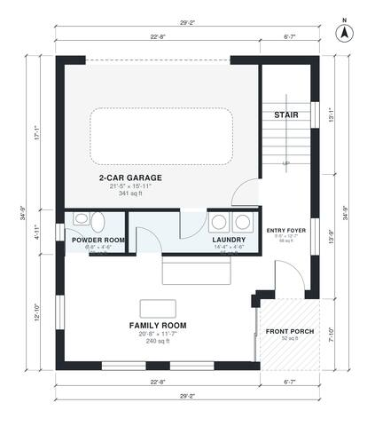

# Split Level Ranch House Plans: 3 Bed, 2.5 Bath, 2,110 Sq Ft

This split-level ranch has about 190 m² (roughly 2,050 sq ft) of living space, plus a 2-car garage and a front porch. The entry level holds the foyer, family room, powder room, laundry and garage. Half a level up is the open living, kitchen and dining area. Half a level above that are three bedrooms, including a primary suite with its own bath, and a shared hall bath.

| | |
|---|---|
| Levels | 3 |
| Footprint | 8.9 m × 10.6 m (29 ft × 35 ft) |
| Rooms | 18 indoor, 3 outdoor |
| Indoor area including garage, from the room grid | about 232 m² (2,499 sq ft) |

## Files here

- `area-schedule.csv` (room schedule)
- `building.json` (rooms, walls, openings as data)
- `plan-level1.dxf` (floor plan, DXF, drawing units: inches)
- `plan-level2.dxf` (floor plan, DXF, drawing units: inches)
- `plan-level3.dxf` (floor plan, DXF, drawing units: inches)

## More for this plan

- Plan page with the PDF plan set, IFC and 3D model, and a tool to change the plan: https://floorplan.ai-architectures.com/house-plans/split-level-ranch-house-plans?utm_source=github-plans&utm_medium=probe&utm_campaign=github
- PDF plan set: https://storage.googleapis.com/20img/house-plans/split-level-ranch-house-plans/plan-set.pdf
- IFC model: https://storage.googleapis.com/20img/house-plans/split-level-ranch-house-plans/model.ifc

## Known issues in this drawing

- None found by the automatic checks.

Concept design generated with AI. Not for construction or permit; verify with a licensed professional.
