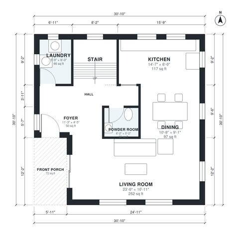

# Square House Plans: 3-Bed, 2.5-Bath Two-Story, 1,830 Sq Ft

A compact square two-story home of about 9.4 m x 9.4 m (roughly 31 ft) with a front porch and no garage. The ground floor has an open kitchen, dining and living area, a powder room and laundry. Upstairs are three bedrooms, a primary suite with walk-in closet and ensuite, and a shared bath, for about 1,850 sq ft of living space.

| | |
|---|---|
| Levels | 2 |
| Footprint | 9.4 m × 9.4 m (31 ft × 31 ft) |
| Rooms | 16 indoor, 1 outdoor |
| Indoor area including garage, from the room grid | about 170 m² (1,831 sq ft) |

## Files here

- `area-schedule.csv` (room schedule)
- `building.json` (rooms, walls, openings as data)
- `plan-level1.dxf` (floor plan, DXF, drawing units: inches)
- `plan-level2.dxf` (floor plan, DXF, drawing units: inches)

## More for this plan

- Plan page with the PDF plan set, IFC and 3D model, and a tool to change the plan: https://floorplan.ai-architectures.com/house-plans/square-house-plans?utm_source=github-plans&utm_medium=probe&utm_campaign=github
- PDF plan set: https://storage.googleapis.com/20img/house-plans/square-house-plans/plan-set.pdf
- IFC model: https://storage.googleapis.com/20img/house-plans/square-house-plans/model.ifc

## Known issues in this drawing

- Bedroom 3 is only 2.44 m wide.

Concept design generated with AI. Not for construction or permit; verify with a licensed professional.
