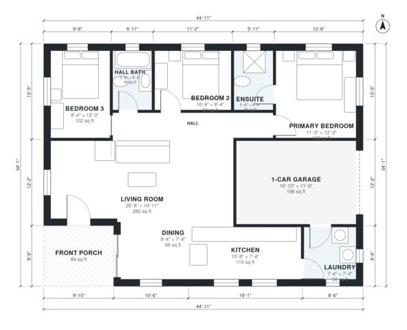

# Starter Home Plans: 3-Bed, 2-Bath Single-Story, 1,230 sq ft

This is a compact single-story 3-bedroom, 2-bath ranch on a simple 13.7 x 10.4 m rectangle (about 142 m² including the porch and 1-car garage, with roughly 112 m² of living space). It has an open kitchen, dining and living area, a central hall to the three bedrooms and the hall bath, and a laundry linking the kitchen to the garage. The revision removes the sliver-sized foyer and walk-in closet, and gives the living room, primary bedroom, Bedroom 3 and laundry more usable space.

| | |
|---|---|
| Levels | 1 |
| Footprint | 13.7 m × 10.4 m (45 ft × 34 ft) |
| Rooms | 11 indoor, 1 outdoor |
| Indoor area including garage, from the room grid | about 135 m² (1,450 sq ft) |

## Files here

- `area-schedule.csv` (room schedule)
- `building.json` (rooms, walls, openings as data)
- `plan-level1.dxf` (floor plan, DXF, drawing units: inches)

## More for this plan

- Plan page with the PDF plan set, IFC and 3D model, and a tool to change the plan: https://floorplan.ai-architectures.com/house-plans/starter-home-plans?utm_source=github-plans&utm_medium=probe&utm_campaign=github
- PDF plan set: https://storage.googleapis.com/20img/house-plans/starter-home-plans/plan-set.pdf
- IFC model: https://storage.googleapis.com/20img/house-plans/starter-home-plans/model.ifc

## Known issues in this drawing

- Dining is 6.4 m² (asked for about 9.0 m²).
- Dining is only 2.24 m wide.

Concept design generated with AI. Not for construction or permit; verify with a licensed professional.
