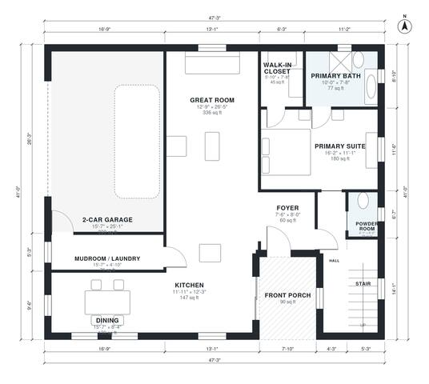

# Story and a Half House Plans: 3-Bed, 2,010 Sq Ft Design

This 1.5-story craftsman has about 180 m² (roughly 1,950 sq ft) of living space, not counting the garage, porch and deck. The main floor holds the great room, kitchen, dining, a primary suite with bath and walk-in closet, a powder room, and a mudroom/laundry next to the 2-car garage. Upstairs are two bedrooms and a bath under the roof. The revision connects the foyer to the main hall and the great room to the stair, and makes the upstairs bath wider.

| | |
|---|---|
| Levels | 2 |
| Footprint | 14.4 m × 12.5 m (47 ft × 41 ft) |
| Rooms | 17 indoor, 2 outdoor |
| Indoor area including garage, from the room grid | about 228 m² (2,453 sq ft) |

## Files here

- `area-schedule.csv` (room schedule)
- `building.json` (rooms, walls, openings as data)
- `plan-level1.dxf` (floor plan, DXF, drawing units: inches)
- `plan-level2.dxf` (floor plan, DXF, drawing units: inches)

## More for this plan

- Plan page with the PDF plan set, IFC and 3D model, and a tool to change the plan: https://floorplan.ai-architectures.com/house-plans/story-and-a-half-house-plans?utm_source=github-plans&utm_medium=probe&utm_campaign=github
- PDF plan set: https://storage.googleapis.com/20img/house-plans/story-and-a-half-house-plans/plan-set.pdf
- IFC model: https://storage.googleapis.com/20img/house-plans/story-and-a-half-house-plans/model.ifc

## Known issues in this drawing

- Dining is only 2.54 m wide.

Concept design generated with AI. Not for construction or permit; verify with a licensed professional.
