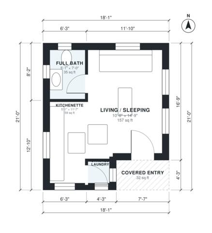

# Studio ADU Plans: 350 Sq Ft Single-Level Backyard Unit

This is a compact studio ADU of about 380 sq ft (35 m²). A covered entry leads into an open living and sleeping room with a galley kitchenette along the west wall. A full bath and a stacked laundry closet are tucked into the corners, and windows on three sides give good daylight.

| | |
|---|---|
| Levels | 1 |
| Footprint | 5.5 m × 6.4 m (18 ft × 21 ft) |
| Rooms | 4 indoor, 1 outdoor |
| Indoor area including garage, from the room grid | about 32 m² (347 sq ft) |

## Files here

- `area-schedule.csv` (room schedule)
- `building.json` (rooms, walls, openings as data)
- `plan-level1.dxf` (floor plan, DXF, drawing units: inches)

## More for this plan

- Plan page with the PDF plan set, IFC and 3D model, and a tool to change the plan: https://floorplan.ai-architectures.com/house-plans/studio-adu-plans?utm_source=github-plans&utm_medium=probe&utm_campaign=github
- PDF plan set: https://storage.googleapis.com/20img/house-plans/studio-adu-plans/plan-set.pdf
- IFC model: https://storage.googleapis.com/20img/house-plans/studio-adu-plans/model.ifc

## Known issues in this drawing

- Kitchenette is only 1.54 m wide.
- Full Bath is 3.3 m² (asked for about 4.6 m²).

Concept design generated with AI. Not for construction or permit; verify with a licensed professional.
