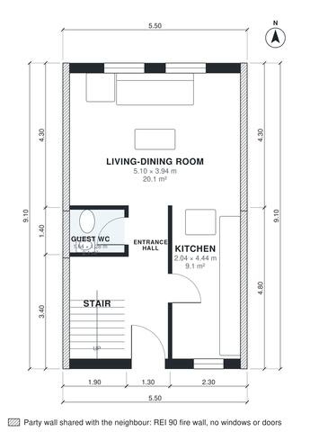

# Terraced House Plans: 3-Bed, 2-Story, 1,080 Sq Ft Design

A 5.5 m wide mid-terrace house of about 100 m² over two floors, with party walls on both sides and windows only front and back. The ground floor has an entrance hall, guest WC, stair and a through kitchen and living-dining room. Upstairs, a central landing serves three bedrooms and a bathroom. Built against the neighbours on the left and right (party walls, fire wall without windows or doors); the rooms take their daylight from the free sides.

| | |
|---|---|
| Levels | 2 |
| Footprint | 5.5 m × 9.1 m (18 ft × 30 ft) |
| Rooms | 11 indoor, 0 outdoor |
| Indoor area including garage, from the room grid | about 100 m² (1,077 sq ft) |

## Files here

- `area-schedule.csv` (room schedule)
- `building.json` (rooms, walls, openings as data)
- `plan-level1.dxf` (floor plan, DXF, drawing units: millimetres)
- `plan-level2.dxf` (floor plan, DXF, drawing units: millimetres)

## More for this plan

- Plan page with the PDF plan set, IFC and 3D model, and a tool to change the plan: https://floorplan.ai-architectures.com/house-plans/terraced-house-plans?utm_source=github-plans&utm_medium=probe&utm_campaign=github
- PDF plan set: https://storage.googleapis.com/20img/house-plans/terraced-house-plans/plan-set.pdf
- IFC model: https://storage.googleapis.com/20img/house-plans/terraced-house-plans/model.ifc

## Known issues in this drawing

- Kitchen is only 2.04 m wide.
- Bedroom 3 is only 2.14 m wide.

Concept design generated with AI. Not for construction or permit; verify with a licensed professional.
