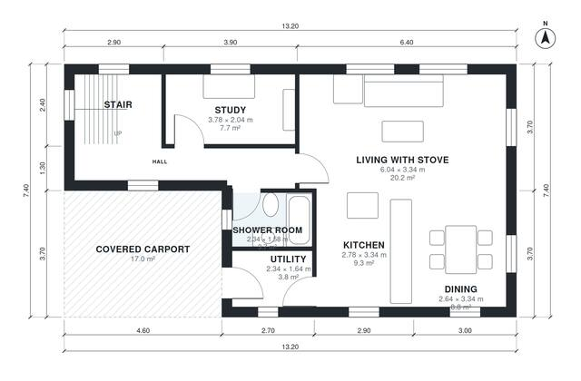

# Timber Frame House Plans: 4 Bed 2 Bath Two-Story, 1,730 Sq Ft

A compact two-storey timber-frame house of about 160 m² of living space on a 13.2 x 7.4 m grid, with a covered one-car carport at the front. The ground floor has an open kitchen, dining and living room with a stove, plus a study, shower room, utility and hall. The four bedrooms and the family bath are all off a single landing upstairs. The utility and bathroom are a little smaller than the brief asked for, and these can be adjusted later if you want.

| | |
|---|---|
| Levels | 2 |
| Footprint | 13.2 m × 7.4 m (43 ft × 24 ft) |
| Rooms | 15 indoor, 2 outdoor |
| Indoor area including garage, from the room grid | about 160 m² (1,726 sq ft) |

## Files here

- `area-schedule.csv` (room schedule)
- `building.json` (rooms, walls, openings as data)
- `plan-level1.dxf` (floor plan, DXF, drawing units: millimetres)
- `plan-level2.dxf` (floor plan, DXF, drawing units: millimetres)

## More for this plan

- Plan page with the PDF plan set, IFC and 3D model, and a tool to change the plan: https://floorplan.ai-architectures.com/house-plans/timber-frame-house-plans?utm_source=github-plans&utm_medium=probe&utm_campaign=github
- PDF plan set: https://storage.googleapis.com/20img/house-plans/timber-frame-house-plans/plan-set.pdf
- IFC model: https://storage.googleapis.com/20img/house-plans/timber-frame-house-plans/model.ifc

## Known issues in this drawing

- Bathroom is 5.0 m² (asked for about 7.0 m²).

Concept design generated with AI. Not for construction or permit; verify with a licensed professional.
