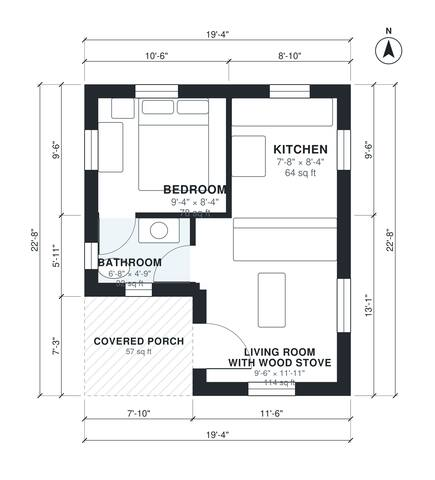

# Tiny Cabin Plans: 1 Bed, 1 Bath, 380 Sq Ft with Wood Stove

A compact cabin of about 42 m² (about 450 sq ft), including a 6 m² covered porch. The heated interior is about 36 m² (390 sq ft), close to your 380 sq ft target. It has an open kitchen and living area built around a wood stove, a private bedroom and a full bath, both reached from a small hall, and a covered front porch.

| | |
|---|---|
| Levels | 1 |
| Footprint | 5.9 m × 6.9 m (19 ft × 23 ft) |
| Rooms | 4 indoor, 1 outdoor |
| Indoor area including garage, from the room grid | about 35 m² (381 sq ft) |

## Files here

- `area-schedule.csv` (room schedule)
- `building.json` (rooms, walls, openings as data)
- `plan-level1.dxf` (floor plan, DXF, drawing units: inches)

## More for this plan

- Plan page with the PDF plan set, IFC and 3D model, and a tool to change the plan: https://floorplan.ai-architectures.com/house-plans/tiny-cabin-plans?utm_source=github-plans&utm_medium=probe&utm_campaign=github
- PDF plan set: https://storage.googleapis.com/20img/house-plans/tiny-cabin-plans/plan-set.pdf
- IFC model: https://storage.googleapis.com/20img/house-plans/tiny-cabin-plans/model.ifc

## Known issues in this drawing

- Living Room with Wood Stove and Bedroom are not directly connected.
- Bathroom is 2.9 m² (asked for about 4.5 m²).
- Living Room with Wood Stove is only 2.90 m wide.
- Kitchen is 5.9 m² (asked for about 8.5 m²).

Concept design generated with AI. Not for construction or permit; verify with a licensed professional.
