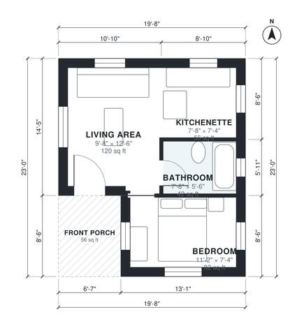

# Tiny House Floor Plans: 1 Bedroom, 1 Bath, 400 Sq Ft Plan

This is a compact 1-bedroom, 1-bath tiny house of about 400 sq ft indoors, plus a small front porch, on a 6 x 7 m footprint. You enter from the porch into an open living area and kitchenette, and the bedroom and bathroom sit at the back for some privacy. The revision drops the separate hall so the living area, kitchenette and bathroom get more usable space.

| | |
|---|---|
| Levels | 1 |
| Footprint | 6.0 m × 7.0 m (20 ft × 23 ft) |
| Rooms | 4 indoor, 1 outdoor |
| Indoor area including garage, from the room grid | about 37 m² (396 sq ft) |

## Files here

- `area-schedule.csv` (room schedule)
- `building.json` (rooms, walls, openings as data)
- `plan-level1.dxf` (floor plan, DXF, drawing units: inches)

## More for this plan

- Plan page with the PDF plan set, IFC and 3D model, and a tool to change the plan: https://floorplan.ai-architectures.com/house-plans/tiny-house-floor-plans?utm_source=github-plans&utm_medium=probe&utm_campaign=github
- PDF plan set: https://storage.googleapis.com/20img/house-plans/tiny-house-floor-plans/plan-set.pdf
- IFC model: https://storage.googleapis.com/20img/house-plans/tiny-house-floor-plans/model.ifc

## Known issues in this drawing

- Bedroom is only 2.24 m wide.
- Living Area is 11.2 m² (asked for about 16.5 m²).

Concept design generated with AI. Not for construction or permit; verify with a licensed professional.
