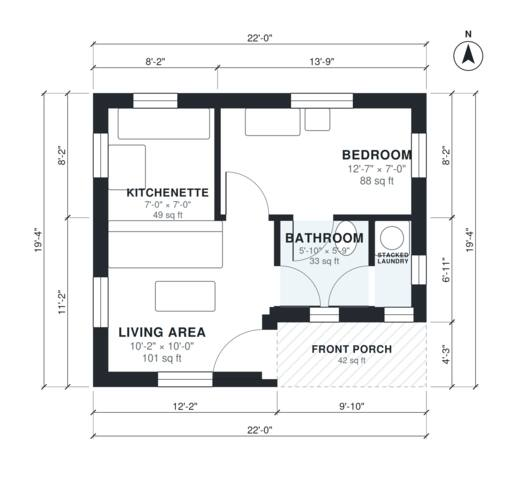

# Tiny House Plans 1 Bedroom: 380 Sq Ft Single-Level Layout

This is a one-level tiny house of about 39 m² (420 sq ft), including a small front porch. The front door opens into a bright living area with an open kitchenette. The bedroom, full bath and stacked laundry closet are grouped together at the back, so the plumbing is shared. The layout is efficient, with almost no wasted circulation space.

| | |
|---|---|
| Levels | 1 |
| Footprint | 6.7 m × 5.9 m (22 ft × 19 ft) |
| Rooms | 5 indoor, 1 outdoor |
| Indoor area including garage, from the room grid | about 36 m² (384 sq ft) |

## Files here

- `area-schedule.csv` (room schedule)
- `building.json` (rooms, walls, openings as data)
- `plan-level1.dxf` (floor plan, DXF, drawing units: inches)

## More for this plan

- Plan page with the PDF plan set, IFC and 3D model, and a tool to change the plan: https://floorplan.ai-architectures.com/house-plans/tiny-house-plans-1-bedroom?utm_source=github-plans&utm_medium=probe&utm_campaign=github
- PDF plan set: https://storage.googleapis.com/20img/house-plans/tiny-house-plans-1-bedroom/plan-set.pdf
- IFC model: https://storage.googleapis.com/20img/house-plans/tiny-house-plans-1-bedroom/model.ifc

## Known issues in this drawing

- Living Area is 9.4 m² (asked for about 13.0 m²).
- Kitchenette is only 2.14 m wide.
- Bedroom is only 2.14 m wide.

Concept design generated with AI. Not for construction or permit; verify with a licensed professional.
