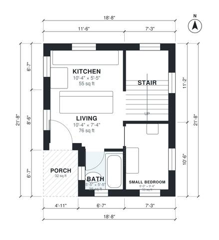

# Tiny House Plans With Loft: 580 Sq Ft, 2 Bed, 1 Bath Plan

This is a compact two-level modern cabin of about 46 m² (roughly 500 sq ft) of living space. It has a front porch and an open kitchen and living area on the ground floor, with a full bath and a small bedroom. A stair along the east side leads up to a bright sleeping loft with windows on all four sides.

| | |
|---|---|
| Levels | 2 |
| Footprint | 5.7 m × 6.6 m (19 ft × 22 ft) |
| Rooms | 7 indoor, 2 outdoor |
| Indoor area including garage, from the room grid | about 54 m² (581 sq ft) |

## Files here

- `area-schedule.csv` (room schedule)
- `building.json` (rooms, walls, openings as data)
- `plan-level1.dxf` (floor plan, DXF, drawing units: inches)
- `plan-level2.dxf` (floor plan, DXF, drawing units: inches)

## More for this plan

- Plan page with the PDF plan set, IFC and 3D model, and a tool to change the plan: https://floorplan.ai-architectures.com/house-plans/tiny-house-plans-with-loft?utm_source=github-plans&utm_medium=probe&utm_campaign=github
- PDF plan set: https://storage.googleapis.com/20img/house-plans/tiny-house-plans-with-loft/plan-set.pdf
- IFC model: https://storage.googleapis.com/20img/house-plans/tiny-house-plans-with-loft/model.ifc

## Known issues in this drawing

- Bath is 2.7 m² (asked for about 4.0 m²).
- Living is 7.0 m² (asked for about 10.0 m²).
- Small Bedroom is 5.2 m² (asked for about 7.0 m²).
- Small Bedroom is only 1.84 m wide.

Concept design generated with AI. Not for construction or permit; verify with a licensed professional.
