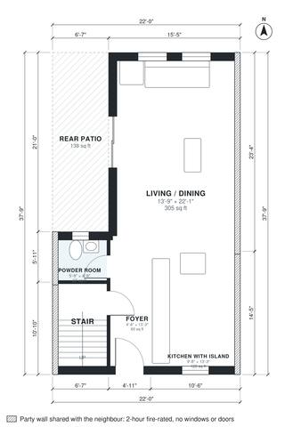

# Townhouse Floor Plans: 3 Bed, 2.5 Bath, 1,520 Sq Ft Plan

This is a 22 ft wide, two-storey mid-terrace townhouse of about 1,500 sq ft, with windows only on the front and rear. The ground floor has a foyer, powder room, and an open kitchen with island flowing into a living/dining room that opens onto a rear patio. Upstairs are a rear primary suite with bath and walk-in closet, two further bedrooms, a hall bath and a laundry room, all off one central hall. Built against the neighbours on the left and right (party walls, fire wall without windows or doors); the rooms take their daylight from the free sides.

| | |
|---|---|
| Levels | 2 |
| Footprint | 6.7 m × 11.5 m (22 ft × 38 ft) |
| Rooms | 14 indoor, 1 outdoor |
| Indoor area including garage, from the room grid | about 141 m² (1,521 sq ft) |

## Files here

- `area-schedule.csv` (room schedule)
- `building.json` (rooms, walls, openings as data)
- `plan-level1.dxf` (floor plan, DXF, drawing units: inches)
- `plan-level2.dxf` (floor plan, DXF, drawing units: inches)

## More for this plan

- Plan page with the PDF plan set, IFC and 3D model, and a tool to change the plan: https://floorplan.ai-architectures.com/house-plans/townhouse-floor-plans?utm_source=github-plans&utm_medium=probe&utm_campaign=github
- PDF plan set: https://storage.googleapis.com/20img/house-plans/townhouse-floor-plans/plan-set.pdf
- IFC model: https://storage.googleapis.com/20img/house-plans/townhouse-floor-plans/model.ifc

## Known issues in this drawing

- Powder Room is 2.5 m² (asked for about 3.5 m²).
- Primary Bath is only 1.74 m wide.

Concept design generated with AI. Not for construction or permit; verify with a licensed professional.
