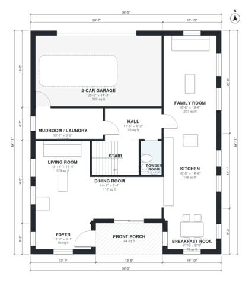

# Traditional House Plans: 4-Bed, 2,410 Sq Ft Two-Story Home

This two-story traditional home has about 225 m² (about 2,420 sq ft) of living space, plus an attached 2-car garage and a front porch. The ground floor has a living room, dining room, an open kitchen with breakfast nook and family room, a powder room, and a mudroom/laundry next to the garage. Upstairs, four bedrooms, including a primary suite with bath and walk-in closet, sit off one hall with a shared hall bath.

| | |
|---|---|
| Levels | 2 |
| Footprint | 11.7 m × 13.7 m (38 ft × 45 ft) |
| Rooms | 20 indoor, 2 outdoor |
| Indoor area including garage, from the room grid | about 262 m² (2,821 sq ft) |

## Files here

- `area-schedule.csv` (room schedule)
- `building.json` (rooms, walls, openings as data)
- `plan-level1.dxf` (floor plan, DXF, drawing units: inches)
- `plan-level2.dxf` (floor plan, DXF, drawing units: inches)

## More for this plan

- Plan page with the PDF plan set, IFC and 3D model, and a tool to change the plan: https://floorplan.ai-architectures.com/house-plans/traditional-house-plans?utm_source=github-plans&utm_medium=probe&utm_campaign=github
- PDF plan set: https://storage.googleapis.com/20img/house-plans/traditional-house-plans/plan-set.pdf
- IFC model: https://storage.googleapis.com/20img/house-plans/traditional-house-plans/model.ifc

## Known issues in this drawing

- Foyer is 5.2 m² (asked for about 8.0 m²).
- Dining Room is only 2.54 m wide.
- Breakfast Nook is 7.3 m² (asked for about 11.0 m²).

Concept design generated with AI. Not for construction or permit; verify with a licensed professional.
