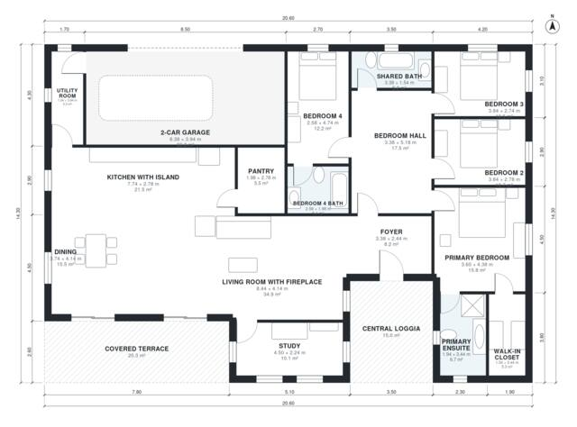

# Tuscan House Plans: 2,400 Sq Ft, 4-Bed Single-Story Villa

A single-storey Tuscan villa of about 215 m² of living space, with a 2-car garage attached through the utility room. A central loggia leads into the foyer. The open kitchen, dining and fireplace living room face a covered terrace. The primary suite and three more bedrooms sit in a private wing off a central hall.

| | |
|---|---|
| Levels | 1 |
| Footprint | 20.6 m × 14.3 m (68 ft × 47 ft) |
| Rooms | 17 indoor, 2 outdoor |
| Indoor area including garage, from the room grid | about 259 m² (2,791 sq ft) |

## Files here

- `area-schedule.csv` (room schedule)
- `building.json` (rooms, walls, openings as data)
- `plan-level1.dxf` (floor plan, DXF, drawing units: millimetres)

## More for this plan

- Plan page with the PDF plan set, IFC and 3D model, and a tool to change the plan: https://floorplan.ai-architectures.com/house-plans/tuscan-house-plans?utm_source=github-plans&utm_medium=probe&utm_campaign=github
- PDF plan set: https://storage.googleapis.com/20img/house-plans/tuscan-house-plans/plan-set.pdf
- IFC model: https://storage.googleapis.com/20img/house-plans/tuscan-house-plans/model.ifc

## Known issues in this drawing

- Utility Room is only 1.34 m wide.

Concept design generated with AI. Not for construction or permit; verify with a licensed professional.
