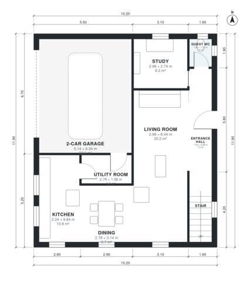

# Two Storey Villa Plans: 4 Bed, 2.5 Bath, 1,830 Sq Ft Hip Roof

A compact two-storey hip-roof villa with about 170 m² of living space, plus an attached 2-car garage. The ground floor has an entrance hall with the stair, an open kitchen, dining and living area, a study, a guest WC and a utility room that connects to the garage. Upstairs are four bedrooms, a family bath and a primary ensuite, with a terrace over the garage.

| | |
|---|---|
| Levels | 2 |
| Footprint | 10.2 m × 11.9 m (33 ft × 39 ft) |
| Rooms | 17 indoor, 1 outdoor |
| Indoor area including garage, from the room grid | about 207 m² (2,229 sq ft) |

## Files here

- `area-schedule.csv` (room schedule)
- `building.json` (rooms, walls, openings as data)
- `plan-level1.dxf` (floor plan, DXF, drawing units: millimetres)
- `plan-level2.dxf` (floor plan, DXF, drawing units: millimetres)

## More for this plan

- Plan page with the PDF plan set, IFC and 3D model, and a tool to change the plan: https://floorplan.ai-architectures.com/house-plans/two-storey-villa-plans?utm_source=github-plans&utm_medium=probe&utm_campaign=github
- PDF plan set: https://storage.googleapis.com/20img/house-plans/two-storey-villa-plans/plan-set.pdf
- IFC model: https://storage.googleapis.com/20img/house-plans/two-storey-villa-plans/model.ifc

## Known issues in this drawing

- Living Room is only 2.98 m wide.
- Guest WC is 1.9 m² (asked for about 3.0 m²).

Concept design generated with AI. Not for construction or permit; verify with a licensed professional.
