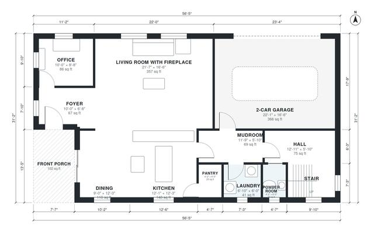

# Two Story Craftsman House Plans: 4 Bed, 2,590 Sq Ft

This is a two-story craftsman of about 2,550 sq ft of living space (about 237 m²), plus a 2-car garage and a front porch. The ground floor has an open living, dining and kitchen area with a fireplace, an office off the foyer, a mudroom and laundry beside the garage, a pantry and a powder room. Upstairs, four bedrooms open off a central hall, including a primary suite with a bath and a walk-in closet, and there is a shared hall bath.

| | |
|---|---|
| Levels | 2 |
| Footprint | 17.2 m × 9.5 m (56 ft × 31 ft) |
| Rooms | 21 indoor, 2 outdoor |
| Indoor area including garage, from the room grid | about 279 m² (2,999 sq ft) |

## Files here

- `area-schedule.csv` (room schedule)
- `building.json` (rooms, walls, openings as data)
- `plan-level1.dxf` (floor plan, DXF, drawing units: inches)
- `plan-level2.dxf` (floor plan, DXF, drawing units: inches)

## More for this plan

- Plan page with the PDF plan set, IFC and 3D model, and a tool to change the plan: https://floorplan.ai-architectures.com/house-plans/two-story-craftsman-house-plans?utm_source=github-plans&utm_medium=probe&utm_campaign=github
- PDF plan set: https://storage.googleapis.com/20img/house-plans/two-story-craftsman-house-plans/plan-set.pdf
- IFC model: https://storage.googleapis.com/20img/house-plans/two-story-craftsman-house-plans/model.ifc

## Known issues in this drawing

- Bedroom 3 is only 2.14 m wide.
- Primary Bedroom is only 2.84 m wide.

Concept design generated with AI. Not for construction or permit; verify with a licensed professional.
