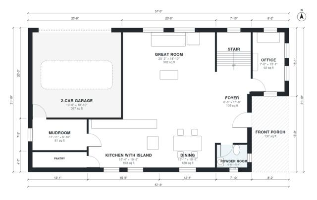

# Two Story Farmhouse Plans: 4 Bed, 2.5 Bath, 2,530 Sq Ft

This is a two-story modern farmhouse of about 2,500 sq ft of living space, plus a 2-car garage and a front porch. The ground floor has an open great room, kitchen with island and dining, with an office, mudroom, pantry and powder room. Upstairs, the primary suite with its bath and walk-in closet and three more bedrooms all open off a central hall, and there is a hall bath and a laundry room.

| | |
|---|---|
| Levels | 2 |
| Footprint | 17.5 m × 9.7 m (57 ft × 32 ft) |
| Rooms | 20 indoor, 2 outdoor |
| Indoor area including garage, from the room grid | about 273 m² (2,942 sq ft) |

## Files here

- `area-schedule.csv` (room schedule)
- `building.json` (rooms, walls, openings as data)
- `plan-level1.dxf` (floor plan, DXF, drawing units: inches)
- `plan-level2.dxf` (floor plan, DXF, drawing units: inches)

## More for this plan

- Plan page with the PDF plan set, IFC and 3D model, and a tool to change the plan: https://floorplan.ai-architectures.com/house-plans/two-story-farmhouse-plans?utm_source=github-plans&utm_medium=probe&utm_campaign=github
- PDF plan set: https://storage.googleapis.com/20img/house-plans/two-story-farmhouse-plans/plan-set.pdf
- IFC model: https://storage.googleapis.com/20img/house-plans/two-story-farmhouse-plans/model.ifc

## Known issues in this drawing

- None found by the automatic checks.

Concept design generated with AI. Not for construction or permit; verify with a licensed professional.
