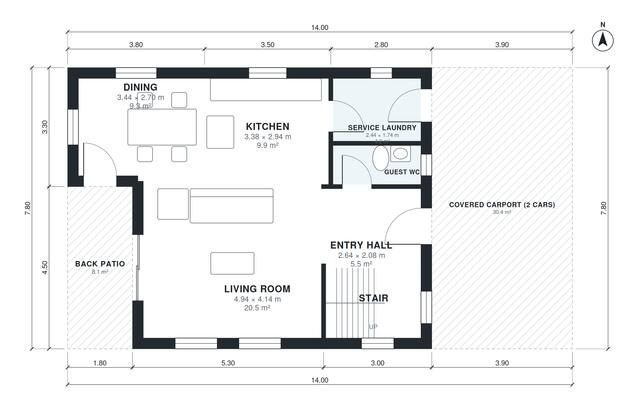

# Two Story House Plans With Carport: 3 Bed, 1,590 Sq Ft

This is a compact two-storey house of about 138 m² of living space on an 11.2 x 9.8 m footprint. A covered two-car carport sits at the front. The ground floor has an entry hall, living room, open kitchen and dining area, guest WC, service laundry and a back patio. Upstairs are a primary suite with ensuite, two further bedrooms and a shared bath, all off a central hall.

| | |
|---|---|
| Levels | 2 |
| Footprint | 14.0 m × 7.8 m (46 ft × 26 ft) |
| Rooms | 14 indoor, 3 outdoor |
| Indoor area including garage, from the room grid | about 148 m² (1,592 sq ft) |

## Files here

- `area-schedule.csv` (room schedule)
- `building.json` (rooms, walls, openings as data)
- `plan-level1.dxf` (floor plan, DXF, drawing units: millimetres)
- `plan-level2.dxf` (floor plan, DXF, drawing units: millimetres)

## More for this plan

- Plan page with the PDF plan set, IFC and 3D model, and a tool to change the plan: https://floorplan.ai-architectures.com/house-plans/two-story-house-plans-with-carport?utm_source=github-plans&utm_medium=probe&utm_campaign=github
- PDF plan set: https://storage.googleapis.com/20img/house-plans/two-story-house-plans-with-carport/plan-set.pdf
- IFC model: https://storage.googleapis.com/20img/house-plans/two-story-house-plans-with-carport/model.ifc

## Known issues in this drawing

- Primary Bedroom is only 2.64 m wide.

Concept design generated with AI. Not for construction or permit; verify with a licensed professional.
