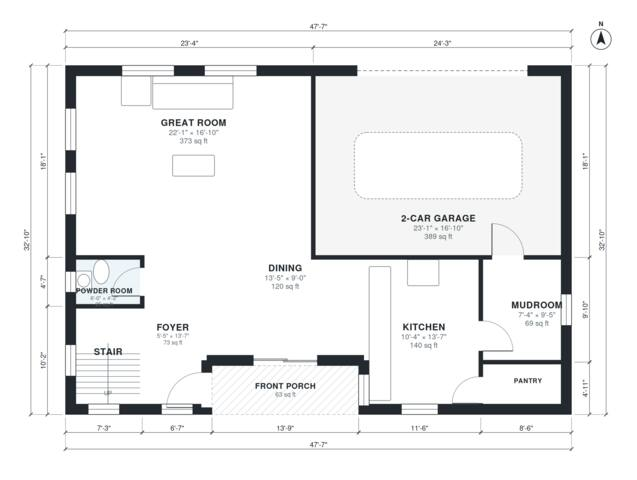

# Two Story House Plans: 3-Bed, 2,250 Sq Ft with Garage

This 2-story modern farmhouse has about 2,240 sq ft of living space plus a 2-car garage and front porch. Downstairs, the kitchen, dining room and great room form one open space, with a powder room and a mudroom that leads to the garage. Upstairs, a central hall serves the primary suite with its walk-in closet, two more bedrooms, a hall bath, the laundry and a loft.

| | |
|---|---|
| Levels | 2 |
| Footprint | 14.5 m × 10.0 m (48 ft × 33 ft) |
| Rooms | 19 indoor, 2 outdoor |
| Indoor area including garage, from the room grid | about 250 m² (2,687 sq ft) |

## Files here

- `area-schedule.csv` (room schedule)
- `building.json` (rooms, walls, openings as data)
- `plan-level1.dxf` (floor plan, DXF, drawing units: inches)
- `plan-level2.dxf` (floor plan, DXF, drawing units: inches)

## More for this plan

- Plan page with the PDF plan set, IFC and 3D model, and a tool to change the plan: https://floorplan.ai-architectures.com/house-plans/two-story-house-plans?utm_source=github-plans&utm_medium=probe&utm_campaign=github
- PDF plan set: https://storage.googleapis.com/20img/house-plans/two-story-house-plans/plan-set.pdf
- IFC model: https://storage.googleapis.com/20img/house-plans/two-story-house-plans/model.ifc

## Known issues in this drawing

- Kitchen is 13.0 m² (asked for about 20.0 m²).
- Primary Bedroom is only 2.74 m wide.

Concept design generated with AI. Not for construction or permit; verify with a licensed professional.
