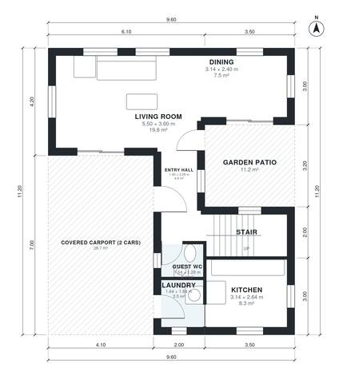

# Two Story Minimalist House Plans | 3 Bed, 1,440 Sq Ft

A compact two-storey flat-roof house with about 140 m² of living space. The ground floor has an open kitchen, dining and living area opening to a garden patio, plus a guest WC and laundry, with a covered two-car carport at the front. Upstairs are three bedrooms, a bath, an ensuite and a terrace.

| | |
|---|---|
| Levels | 2 |
| Footprint | 9.6 m × 11.2 m (31 ft × 37 ft) |
| Rooms | 14 indoor, 4 outdoor |
| Indoor area including garage, from the room grid | about 134 m² (1,440 sq ft) |

## Files here

- `area-schedule.csv` (room schedule)
- `building.json` (rooms, walls, openings as data)
- `plan-level1.dxf` (floor plan, DXF, drawing units: millimetres)
- `plan-level2.dxf` (floor plan, DXF, drawing units: millimetres)

## More for this plan

- Plan page with the PDF plan set, IFC and 3D model, and a tool to change the plan: https://floorplan.ai-architectures.com/house-plans/two-story-minimalist-house-plans?utm_source=github-plans&utm_medium=probe&utm_campaign=github
- PDF plan set: https://storage.googleapis.com/20img/house-plans/two-story-minimalist-house-plans/plan-set.pdf
- IFC model: https://storage.googleapis.com/20img/house-plans/two-story-minimalist-house-plans/model.ifc

## Known issues in this drawing

- Laundry is 3.0 m² (asked for about 4.5 m²).
- Entry Hall is 4.6 m² (asked for about 7.0 m²).
- Kitchen is 8.3 m² (asked for about 12.0 m²).
- Dining is 7.5 m² (asked for about 11.0 m²).
- Dining is only 2.40 m wide.
- Primary Bedroom is only 2.64 m wide.
- Ensuite is 3.7 m² (asked for about 5.5 m²).

Concept design generated with AI. Not for construction or permit; verify with a licensed professional.
