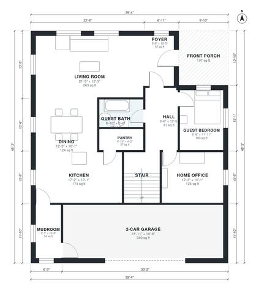

# Two Story Modern House Plans: 4 Bed, 3 Bath, 2,680 Sq Ft

This two-story modern home has about 247 m² (roughly 2,660 sq ft) of living space, with a 2-car garage on top of that. The ground floor has an open kitchen, dining and living area, a guest bedroom with its own bath, a home office, a pantry and a mudroom next to the garage. Upstairs are the primary suite with a walk-in closet and ensuite, two more bedrooms, a hall bath, a laundry room and a family loft, all off one central hall.

| | |
|---|---|
| Levels | 2 |
| Footprint | 12.0 m × 14.1 m (39 ft × 46 ft) |
| Rooms | 22 indoor, 2 outdoor |
| Indoor area including garage, from the room grid | about 285 m² (3,071 sq ft) |

## Files here

- `area-schedule.csv` (room schedule)
- `building.json` (rooms, walls, openings as data)
- `plan-level1.dxf` (floor plan, DXF, drawing units: inches)
- `plan-level2.dxf` (floor plan, DXF, drawing units: inches)

## More for this plan

- Plan page with the PDF plan set, IFC and 3D model, and a tool to change the plan: https://floorplan.ai-architectures.com/house-plans/two-story-modern-house-plans?utm_source=github-plans&utm_medium=probe&utm_campaign=github
- PDF plan set: https://storage.googleapis.com/20img/house-plans/two-story-modern-house-plans/plan-set.pdf
- IFC model: https://storage.googleapis.com/20img/house-plans/two-story-modern-house-plans/model.ifc

## Known issues in this drawing

- Front Porch is not on the street side.
- Mudroom is 5.0 m² (asked for about 7.0 m²).

Concept design generated with AI. Not for construction or permit; verify with a licensed professional.
