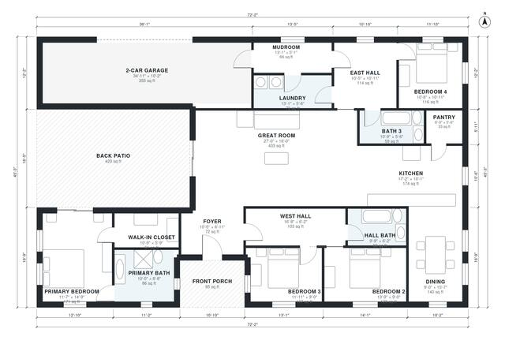

# U Shaped House Plans: Single-Story 4 Bed, 3 Bath, 2,320 Sq Ft

A single-story U-shaped ranch of about 300 m² (3,250 sq ft) under roof, including the garage and patio, with about 216 m² (2,325 sq ft) of living space. The great room, kitchen and dining form the base of the U, and both wings wrap a 38 m² back patio. The east side of the plan holds the primary suite and two more bedrooms. The 2-car garage wing holds the laundry, mudroom and fourth bedroom with its own bath.

| | |
|---|---|
| Levels | 1 |
| Footprint | 22.0 m × 13.8 m (72 ft × 45 ft) |
| Rooms | 18 indoor, 2 outdoor |
| Indoor area including garage, from the room grid | about 257 m² (2,763 sq ft) |

## Files here

- `area-schedule.csv` (room schedule)
- `building.json` (rooms, walls, openings as data)
- `plan-level1.dxf` (floor plan, DXF, drawing units: inches)

## More for this plan

- Plan page with the PDF plan set, IFC and 3D model, and a tool to change the plan: https://floorplan.ai-architectures.com/house-plans/u-shaped-house-plans?utm_source=github-plans&utm_medium=probe&utm_campaign=github
- PDF plan set: https://storage.googleapis.com/20img/house-plans/u-shaped-house-plans/plan-set.pdf
- IFC model: https://storage.googleapis.com/20img/house-plans/u-shaped-house-plans/model.ifc

## Known issues in this drawing

- Dining and Back Patio are not directly connected.
- West Hall and Primary Bedroom are not directly connected.
- Foyer is 6.7 m² (asked for about 9.0 m²).

Concept design generated with AI. Not for construction or permit; verify with a licensed professional.
