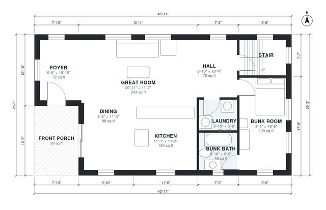

# Vacation Home Plans: 3-Bed, 3-Bath Two-Story, 1,790 Sq Ft

This two-story coastal cottage has about 170 m² (1,830 sq ft) of living space plus a covered front porch. The ground floor has an open great room, kitchen and dining area along the south and east sides, a bunk room with its own bath, and a laundry. Upstairs are a primary suite with a walk-in closet and a second bedroom with its own bath, all off one hall.

| | |
|---|---|
| Levels | 2 |
| Footprint | 14.0 m × 7.7 m (46 ft × 25 ft) |
| Rooms | 16 indoor, 2 outdoor |
| Indoor area including garage, from the room grid | about 166 m² (1,792 sq ft) |

## Files here

- `area-schedule.csv` (room schedule)
- `building.json` (rooms, walls, openings as data)
- `plan-level1.dxf` (floor plan, DXF, drawing units: inches)
- `plan-level2.dxf` (floor plan, DXF, drawing units: inches)

## More for this plan

- Plan page with the PDF plan set, IFC and 3D model, and a tool to change the plan: https://floorplan.ai-architectures.com/house-plans/vacation-home-plans?utm_source=github-plans&utm_medium=probe&utm_campaign=github
- PDF plan set: https://storage.googleapis.com/20img/house-plans/vacation-home-plans/plan-set.pdf
- IFC model: https://storage.googleapis.com/20img/house-plans/vacation-home-plans/model.ifc

## Known issues in this drawing

- None found by the automatic checks.

Concept design generated with AI. Not for construction or permit; verify with a licensed professional.
